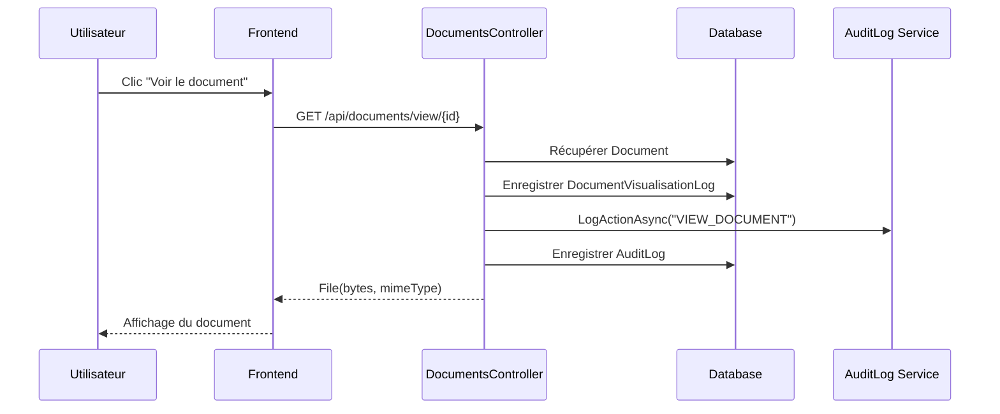

# Système de Traçabilité des Documents - SIGAC

## Vue d'ensemble

SIGAC intègre un système complet de traçabilité pour tous les documents, permettant de suivre chaque consultation, téléchargement et modification. Ce système assure la conformité RGPD et offre un audit complet des accès aux documents sensibles.

## Architecture du Système

### 1. Double Logging Centralisé

Chaque action sur un document est enregistrée dans **deux systèmes complémentaires** :

#### A. `DocumentVisualisationLog` (Table dédiée)
```csharp
public class DocumentVisualisationLog
{
    public Guid Id { get; set; }
    public Guid DocumentId { get; set; }
    public Guid UserId { get; set; }
    public DateTime DateVisualisation { get; set; }
    public string TypeVisualisation { get; set; } // "view", "download"
    public string? IpAddress { get; set; }
    public string? UserAgent { get; set; }
}
```

**Avantages** :
- Requêtes rapides filtrées par document
- Relations directes avec Document et User
- Optimisé pour les statistiques de consultation

#### B. `AuditLog` (Traçabilité centralisée)
```csharp
public class AuditLog
{
    public Guid Id { get; set; }
    public DateTime Timestamp { get; set; }
    public Guid? UserId { get; set; }
    public string Action { get; set; } // "VIEW_DOCUMENT", "DOWNLOAD_DOCUMENT"
    public string EntityType { get; set; } // "Document"
    public string? EntityId { get; set; }
    public string? NewValues { get; set; } // JSON avec détails
    public string IpAddress { get; set; }
    public string? UserAgent { get; set; }
}
```

**Avantages** :
- Audit centralisé avec toutes les actions système
- Corrélation entre différentes entités
- Conformité pour audits de sécurité

### 2. Actions Tracées

| Action | Description | Endpoint déclenché | Type de log |
|--------|-------------|-------------------|-------------|
| **Visualisation en ligne** | Aperçu du document dans le navigateur | `GET /api/documents/view/{id}` | `VIEW_DOCUMENT` |
| **Téléchargement** | Download du fichier sur l'appareil | `GET /api/documents/download/{id}` | `DOWNLOAD_DOCUMENT` |
| **Upload** | Ajout d'un nouveau document | `POST /api/documents/upload/{dossierId}` | `UPLOAD` (via DocumentService) |
| **Suppression** | Retrait d'un document | `DELETE /api/documents/{id}` | `DELETE` (via DocumentService) |

### 3. Informations Capturées

Pour **chaque consultation** de document, le système enregistre :

```json
{
  "DocumentId": "a1b2c3d4-...",
  "DocumentNom": "Contrat_Client_2025.pdf",
  "TypeVisualisation": "view",
  "IpAddress": "192.168.1.42",
  "UserAgent": "Mozilla/5.0 (Windows NT 10.0; Win64; x64)...",
  "UserId": "e5f6g7h8-...",
  "UserNomComplet": "Marie Dupont",
  "DateVisualisation": "2025-12-28T14:23:45Z"
}
```

### 4. Endpoints API Disponibles

#### Historique par Document
```http
GET /api/documents/{id}/visualisations
Authorization: Bearer <token>
```

**Réponse** :
```json
[
  {
    "id": "...",
    "documentId": "...",
    "documentNom": "Contrat_2025.pdf",
    "userId": "...",
    "userNomComplet": "Jean Martin",
    "dateVisualisation": "2025-12-28T14:30:00Z",
    "typeVisualisation": "download",
    "ipAddress": "192.168.1.50"
  }
]
```

#### Historique par Dossier
```http
GET /api/documents/dossier/{dossierId}/visualisations
Authorization: Bearer <token>
```

Retourne l'historique de **tous les documents** du dossier (limite : 100 dernières entrées).

## Flux de Traçabilité

### Scénario : Utilisateur visualise un document



### Code Backend (simplifié)

```csharp
[HttpGet("view/{id}")]
public async Task<IActionResult> ViewDocument(Guid id)
{
    var document = await _documentService.GetByIdAsync(id);
    if (document == null)
        return NotFound();

    var filePath = GetAbsoluteFilePath(document.CheminFichier);
    var fileBytes = await File.ReadAllBytesAsync(filePath);

    // ✅ Enregistrement automatique dans les deux systèmes
    await LogDocumentVisualisation(id, "view");

    return File(fileBytes, document.MimeType);
}

private async Task LogDocumentVisualisation(Guid documentId, string type)
{
    // 1. Log spécifique
    var log = new DocumentVisualisationLog { ... };
    _context.DocumentVisualisationLogs.Add(log);
    
    // 2. Log centralisé
    await _auditLogRepository.LogActionAsync(
        userId, "VIEW_DOCUMENT", "Document", 
        documentId.ToString(), null, logDetails
    );
}
```

## Cas d'Usage

### 1. Audit de Sécurité
**Besoin** : Identifier qui a consulté un document confidentiel.

**Solution** :
```sql
SELECT u.NomComplet, v.DateVisualisation, v.TypeVisualisation, v.IpAddress
FROM DocumentVisualisationLogs v
JOIN Users u ON v.UserId = u.Id
WHERE v.DocumentId = '<document-id>'
ORDER BY v.DateVisualisation DESC;
```

### 2. Statistiques de Consultation
**Besoin** : Nombre de fois qu'un document a été téléchargé ce mois.

**Solution** :
```http
GET /api/documents/{id}/visualisations
```
Filtrer côté client par `typeVisualisation === "download"` et date.

### 3. Conformité RGPD
**Besoin** : Prouver qu'un utilisateur a eu accès à un document à une date précise.

**Solution** : Les logs dans `AuditLog` sont **immuables** et incluent IP + User-Agent, permettant de répondre aux demandes RGPD.

### 4. Détection d'Anomalies
**Besoin** : Détecter un accès suspect (ex: téléchargements massifs).

**Solution** :
```sql
SELECT u.Username, COUNT(*) as NbDownloads
FROM DocumentVisualisationLogs v
JOIN Users u ON v.UserId = u.Id
WHERE v.TypeVisualisation = 'download'
  AND v.DateVisualisation > NOW() - INTERVAL '1 hour'
GROUP BY u.Username
HAVING COUNT(*) > 50;
```

## Sécurité et Confidentialité

### Protection des Logs
- ✅ **Immuables** : Les logs ne peuvent être modifiés après création
- ✅ **Horodatage UTC** : Timezone neutre pour corrélation internationale
- ✅ **Isolation par Workspace** : Chaque workspace accède uniquement à ses logs
- ✅ **RBAC** : Seuls les admins peuvent lister les historiques

### Données Sensibles
- ❌ **Contenu du document** : Jamais stocké dans les logs
- ✅ **Métadonnées seulement** : Nom du fichier, date, utilisateur
- ✅ **IP anonymisable** : Peut être tronquée selon politique RGPD

## Performance

### Optimisations Implémentées
1. **Index sur `DocumentId` + `DateVisualisation`** : Requêtes rapides
2. **Limite de 100 résultats** : Pagination automatique
3. **Async/Await** : Non-bloquant pour le téléchargement
4. **Try-Catch isolé** : Erreur de log ne bloque pas le téléchargement

### Volumétrie Estimée
- **10 000 documents** dans un dossier actif
- **5 consultations/document/jour** en moyenne
- **50 000 logs/jour** → ~1,5M logs/mois
- **Impact storage** : ~200 MB/an (avec nettoyage annuel)

## Maintenance

### Archivage des Logs Anciens
Script SQL suggéré (à exécuter annuellement) :

```sql
-- Archiver les logs > 3 ans dans une table d'archivage
INSERT INTO DocumentVisualisationLogs_Archive
SELECT * FROM DocumentVisualisationLogs
WHERE DateVisualisation < NOW() - INTERVAL '3 years';

-- Supprimer les logs archivés
DELETE FROM DocumentVisualisationLogs
WHERE DateVisualisation < NOW() - INTERVAL '3 years';
```

### Nettoyage AuditLog
```sql
DELETE FROM AuditLogs
WHERE Timestamp < NOW() - INTERVAL '5 years'
  AND Action IN ('VIEW_DOCUMENT', 'DOWNLOAD_DOCUMENT');
```

## Améliorations Futures

### Phase 2 (Recommandé)
- [ ] **Dashboard Analytics** : Graphiques de consultation dans l'UI
- [ ] **Alertes temps réel** : Webhook sur téléchargements suspects
- [ ] **Export CSV** : Génération de rapports d'audit

### Phase 3 (Optionnel)
- [ ] **Watermarking** : Marquer les PDFs avec userId+timestamp
- [ ] **DLP (Data Loss Prevention)** : Bloquer téléchargements massifs
- [ ] **Géolocalisation IP** : Carte des accès internationaux

## Configuration

### Variables d'Environnement
```bash
# Aucune configuration requise - activé par défaut
# Logging automatique pour tous les endpoints /view et /download
```

### Désactivation (Non recommandé)
Pour désactiver temporairement (tests seulement) :
```csharp
// Dans DocumentsController.cs, commenter :
// await LogDocumentVisualisation(id, "view");
```

## Support et Questions

Pour toute question sur le système de traçabilité :
1. Consulter les logs Serilog : `sigac-backend/logs/sigac-YYYY-MM-DD.txt`
2. Vérifier la table `DocumentVisualisationLogs` dans PostgreSQL
3. Analyser les `AuditLogs` avec filtre `EntityType = 'Document'`

**Note de conformité** : Ce système respecte les exigences RGPD pour la traçabilité des accès aux données personnelles. Les logs sont conservables jusqu'à 5 ans pour preuve légale.
